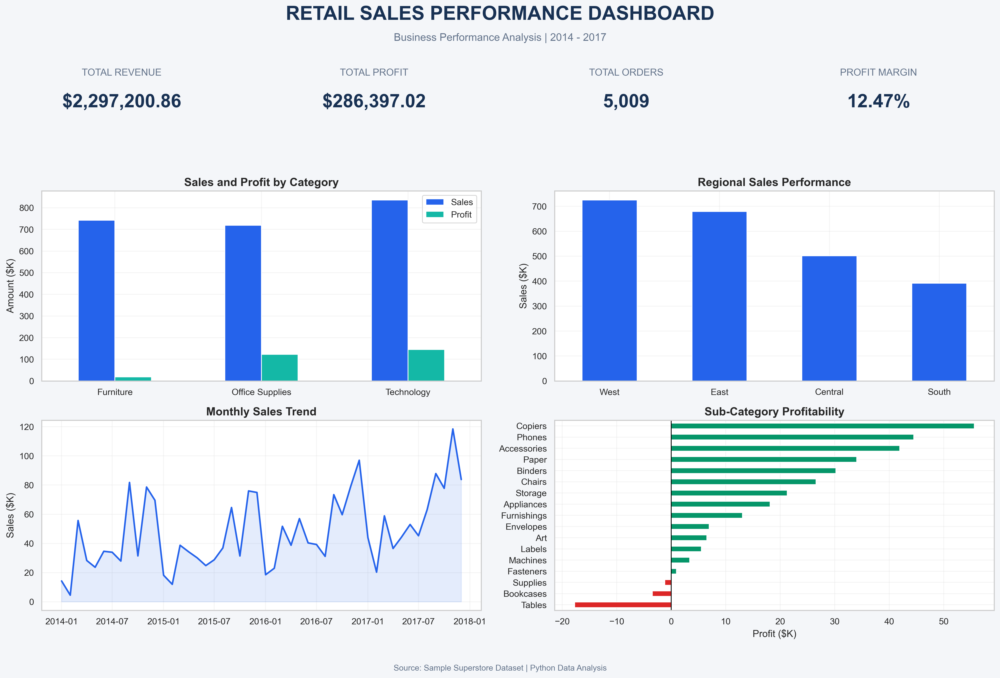

# Retail Sales and Profit Analysis

## Project Overview

An end-to-end retail data analysis project using Python to
evaluate sales performance, profitability, customer segments,
regional performance and business growth.

The project transforms raw retail data into actionable
business insights through data cleaning, exploratory data
analysis and professional visualization.

## Performance Dashboard

## Key Performance Indicators

| Metric | Result |
|---|---:|
| Total Revenue | $2,297,200.86 |
| Total Profit | $286,397.02 |
| Total Orders | 5,009 |
| Total Customers | 793 |
| Profit Margin | 12.47% |
| Average Order Value | $458.61 |
| Total Units Sold | 37,873 |
| Average Shipping Duration | 3.96 days |

## Project Objectives

- Clean and preprocess retail transaction data.
- Analyze sales and profitability.
- Identify top-performing products and categories.
- Evaluate regional and customer segment performance.
- Identify loss-making product categories.
- Provide actionable business recommendations.

## Tools and Technologies

- Python
- Pandas
- NumPy
- Matplotlib
- Seaborn
- Jupyter Notebook

## Dataset

The project uses the Sample Superstore dataset containing
9,994 retail transaction records from 2014 to 2017.

The dataset includes:

- Order and shipping information
- Customer details and segments
- Product categories and sub-categories
- Sales, profit, quantity and discounts
- Regional and geographical information

Dataset source:

[Tableau Sample Datasets](https://public.tableau.com/app/learn/sample-data)

The original dataset is not redistributed in this repository.

## Project Workflow

1. Dataset Loading
2. Data Quality Assessment
3. Data Cleaning
4. Data Preprocessing
5. Exploratory Data Analysis
6. Business KPI Calculation
7. Data Visualization
8. Executive Dashboard Creation
9. Business Recommendations

## Key Business Findings

- Technology generated the highest revenue and profit.
- Furniture achieved substantial sales but a low profit
  margin of approximately 2.49%.
- The West region recorded the highest sales.
- Tables, Bookcases and Supplies generated combined
  losses of approximately $22,387.
- Annual sales increased significantly from 2015 to 2017.
- Discounts showed a negative correlation with profit.
- The Consumer segment generated the highest revenue.

## Business Recommendations

- Prioritize profitable technology products.
- Review furniture pricing and operating costs.
- Investigate loss-making product sub-categories.
- Evaluate regional sales strategies.
- Optimize discount policies to improve profitability.
- Focus on customer retention and targeted marketing.

## Project Structure

    Retail-Sales-Analysis/
    |-- Retail_Sales_Analysis.ipynb
    |-- Retail_Sales_Dashboard.png
    |-- README.md

## How to Run

1. Download or clone this repository.

2. Install the required libraries:

    pip install pandas numpy matplotlib seaborn notebook

3. Obtain the 2014-2017 Sample Superstore dataset in CSV
   format and save it as superstore.csv in the project folder.

4. Open Jupyter Notebook.

5. Open Retail_Sales_Analysis.ipynb.

6. Run all cells sequentially.

The notebook generates the cleaned dataset and dashboard.

## Skills Demonstrated

- Data Cleaning
- Data Preprocessing
- Exploratory Data Analysis
- Business Analytics
- Statistical Analysis
- Data Visualization
- Dashboard Development
- Business Reporting

## Conclusion

This project demonstrates the practical application of data
analytics to support business decision-making and identify
opportunities for improving sales and profitability.

## Author

**Hareem Fatima**

BS Data Science | FAST-NUCES Lahore

Data Analysis | Python | Data Visualization

---

This project was developed for professional portfolio
and educational purposes using a sample retail dataset.
